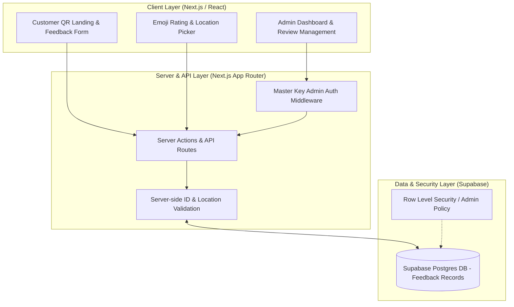

# Peoples Feedback Hub — QR-Driven Customer Feedback & Admin Management System

A modern, full-stack customer feedback and review platform for Peoples Bakers. Built with Next.js App Router, TypeScript, Supabase, and Tailwind CSS. Features emoji-based ratings, shop location tracking, QR code generator designs, and a highly secure Admin Dashboard with strict master key authentication.

Live app: https://peoples-feedback-hub.vercel.app

- Public feedback form: `/`
- Admin dashboard: `/admin`
- Printable QR assets: `qr-designs`

## System Architecture



## Key Features

- Interactive Customer Feedback: Fast emoji-based rating UI with interactive shop location selection and auto-scroll error validation.
- QR Code Assets: Integrated `qr-designs` for table and counter feedback campaigns.
- Secure Admin Portal: Multi-tier admin access control, server-validated feedback deletion, and strict admin filtering.
- Typed Supabase Backend: Full TypeScript database schema integration with strict server-side feedback ID validation.

## Tech Stack

- Framework: Next.js (App Router, TypeScript)
- Database & Auth: Supabase (PostgreSQL, Row Level Security)
- Styling: Tailwind CSS, PostCSS
- Validation & Security: Server-side route validation and master key access restriction

## Getting Started & Local Development

1. Clone the repository and install dependencies:

```bash
npm install
```

2. Copy `.env.example` to `.env.local` and fill in the values. These are the names the app reads. Do not commit `.env.local`.

- `NEXT_PUBLIC_SUPABASE_URL`
- `NEXT_PUBLIC_SUPABASE_ANON_KEY`
- `SUPABASE_SERVICE_ROLE_KEY`
- `ADMIN_EMAIL`
- `ADMIN_PASSWORD`
- `DEVELOPER_MASTER_KEY` — server-only. Required to delete feedback and create extra admin accounts.

3. Run the development server:

```bash
npm run dev
```

4. Build for production:

```bash
npm run build
```

After the first deploy, run `supabase/feedbacks_table.sql`, `supabase/admin_accounts.sql`, and `supabase/security_hardening.sql` once in the Supabase SQL editor. The service role writes feedback and admin accounts. Anonymous read and insert policies are not used.

## License

MIT. See [LICENSE](LICENSE). Copyright (c) 2026 Channa Sandeepa.
